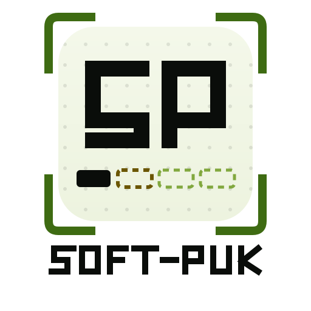

# soft-puk

<p align="center">
  <picture>
    <source media="(prefers-color-scheme: dark)" srcset="assets/brand/logo-dark.svg">
    
  </picture>
</p>

Personal Android app that reads the **Breach Protocol** hacking minigame screen
(Cyberpunk 2077) through the camera, locks the recognized cells, and shows the optimal
click order — fully offline.

> Personal-use project, not affiliated with CD Projekt Red. Cyberpunk 2077 and the
> Breach Protocol minigame belong to their respective owners.

## What it does

1. **Camera (mira)** — point the phone at the game screen; on-device text recognition
   (bundled ML Kit) reads the code matrix and the daemon sequences. Cells lock after a
   few identical reads and are drawn in place over the live preview.
2. **Confirm** — the parsed puzzle opens in an editable grid (tap a cell to cycle its
   code; adjust buffer size and daemons).
3. **Solve** — an exhaustive search finds the selection order that maximizes the reward;
   the solution screen shows a numbered click order, step by step.
4. **Import** — a screenshot can be imported instead of using the camera (Photo Picker,
   no extra permissions).

## Privacy

- **No network permissions at all** — `INTERNET` and `ACCESS_NETWORK_STATE` are
  explicitly removed from the merged manifest.
- OCR runs on-device; nothing leaves the phone.
- The only sensitive permission declared is the camera.

## Build

Requirements: JDK 17+ and an Android SDK (platform 37, build-tools 37).

```bash
./gradlew assembleDebug        # debug APK in app/build/outputs/apk/debug/
./gradlew testDebugUnitTest    # JVM tests (solver + parser)
```

Create `local.properties` with `sdk.dir=/path/to/your/android/sdk` before building.

## Structure

- `app/` — Kotlin + Jetpack Compose (CameraX + ML Kit + solver + parser).
- Gradle 9 / AGP 9 with built-in Kotlin; the Kotlin Gradle plugin version is pinned in
  the root build file.

## License

No license granted — personal project. Cyberpunk 2077 is a trademark of CD Projekt Red.
